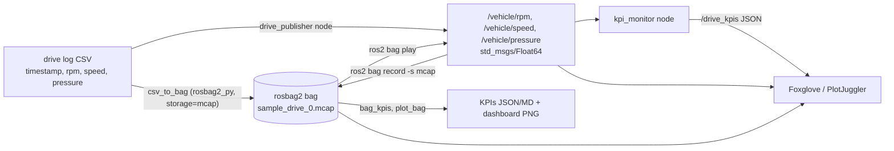

# ROS 2 drive-log rosbag project

This project takes logged vehicle drive data (engine **RPM**, **speed** and **pressure**) and runs it through a ROS 2 pipeline:

1. It runs on **ROS 2 Jazzy**, natively on Ubuntu 24.04 or in Docker.
2. It converts the drive log into a **rosbag2** bag stored as **MCAP**.
3. It publishes the signals as ROS 2 topics and **replays** them with `ros2 bag play`.
4. It shows the data in **Foxglove / PlotJuggler** (layouts included) and computes **KPIs**: max RPM, average speed and dropped messages.


*Rendered from `bags/sample_drive` by `ros2 run drive_bag plot_bag`. Grey bands mark logger gaps, which are the dropped samples.*

## Results (sample drive)

The sample drive lasts 4 min 40 s at 20 Hz and covers city, highway and back to city. It produced **16,719 messages** across three topics in a 968 KiB MCAP file.

| KPI | Value |
|---|---|
| Max RPM | **3231 rpm** |
| Average speed (all samples) | **58.9 km/h** |
| Average speed (moving, >1 km/h) | 71.4 km/h |
| Max speed | 115.3 km/h |
| Distance | 4.58 km |
| Pressure min / max | 169 / 388 kPa |
| Dropped messages in the log | **81 of 16,800 expected (0.48%)** |
| Dropped messages during `ros2 bag play` | **0** (16,719 sent, 16,719 received) |

| Signal | Count | Expected | Dropped | Gap events | Longest gap |
|---|---|---|---|---|---|
| `/vehicle/rpm` | 5581 | 5600 | 19 | 19 | 0.10 s |
| `/vehicle/speed` | 5580 | 5600 | 20 | 20 | 0.10 s |
| `/vehicle/pressure` | 5558 | 5600 | 42 | 11 | 1.65 s (sensor dropout) |

The pipeline counts dropped messages in two ways:

* **In the log:** gaps in the recorded timestamps compared with the nominal 20 Hz rate. These come from the data logger itself. Examples are single missed CAN frames and the 1.6 s pressure-sensor dropout.
* **In replay:** the per-topic message counts in the bag's `metadata.yaml`, compared with what the `kpi_monitor` node actually received over DDS during `ros2 bag play`.

Full output is in [`results/kpis.md`](results/kpis.md), [`results/kpis.json`](results/kpis.json), [`results/replay_kpis.json`](results/replay_kpis.json) and [`results/bag_info.txt`](results/bag_info.txt).

## How it works



| Topic | Type | Unit |
|---|---|---|
| `/vehicle/rpm` | `std_msgs/msg/Float64` | rpm |
| `/vehicle/speed` | `std_msgs/msg/Float64` | km/h |
| `/vehicle/pressure` | `std_msgs/msg/Float64` | kPa |
| `/drive_kpis` | `std_msgs/msg/String` (JSON) | live KPI summary, 1 Hz |

Every message is written with the logger's original timestamp, so `ros2 bag play` reproduces the drive's real timing, including its gaps.

## Quick start (Docker)

```bash
docker build -t ros2-drive-bag .
docker run --rm -v "$PWD":/project ros2-drive-bag scripts/run_demo.sh
```

[`scripts/run_demo.sh`](scripts/run_demo.sh) runs the whole pipeline at 5x playback speed in about a minute. It:

1. converts the CSV to an MCAP bag;
2. runs `ros2 bag info`;
3. replays the bag with `ros2 bag play` while `kpi_monitor` listens;
4. computes the offline KPIs;
5. renders the dashboard.

To get an interactive shell with ROS 2 sourced:

```bash
docker run --rm -it -v "$PWD":/project ros2-drive-bag
```

## Native install (Ubuntu 24.04)

```bash
# ROS 2 Jazzy: https://docs.ros.org/en/jazzy/Installation/Ubuntu-Install-Debs.html
sudo apt install ros-jazzy-ros-base ros-jazzy-rosbag2-storage-mcap python3-colcon-common-extensions python3-matplotlib
source /opt/ros/jazzy/setup.bash
colcon build --symlink-install --base-paths src
source install/setup.bash
```

## Step by step

```bash
# 1. CSV -> rosbag2 (MCAP)
ros2 run drive_bag csv_to_bag data/sample_drive.csv -o bags/sample_drive --force
ros2 bag info bags/sample_drive

# 2. Replay as topics. In another terminal, run: ros2 topic echo /vehicle/rpm
ros2 bag play bags/sample_drive

# 3. Replay + live KPIs in one command (the monitor exits when playback goes quiet)
ros2 launch drive_bag replay.launch.py bag:=bags/sample_drive rate:=5.0

# 4. Offline KPIs + dashboard PNG
ros2 run drive_bag bag_kpis bags/sample_drive -o results
ros2 run drive_bag plot_bag bags/sample_drive -o docs/drive_dashboard.png
```

To record the bag from live topics instead, the way you would on a vehicle:

```bash
ros2 bag record -s mcap -o bags/live_drive /vehicle/rpm /vehicle/speed /vehicle/pressure &
ros2 run drive_bag drive_publisher --ros-args -p csv:=data/sample_drive.csv -p rate:=1.0
```

A recorded bag stores receive time, not the logger's time. Record at `rate:=1.0` if you want the gap-based drop KPI to stay meaningful. `csv_to_bag` keeps the original timestamps exactly.

## Using your own drive log

`csv_to_bag` reads any CSV that has a time column (relative seconds or Unix epoch) and one column per signal. Blank or `NaN` cells count as missed samples.

```bash
ros2 run drive_bag csv_to_bag my_drive.csv -o bags/my_drive \
    --time-col time --rpm-col EngineRPM --speed-col VehicleSpeed --pressure-col OilPressure \
    --zstd                       # optional MCAP chunk compression
ros2 run drive_bag bag_kpis bags/my_drive --rate-hz 50   # set your logger's nominal rate
```

If your existing MCAP logs are not ROS 2 (for example, JSON or Protobuf channels), export them to CSV, or read them with the `mcap` Python package. Then feed them through `csv_to_bag` to get a rosbag2 bag that `ros2 bag play` can replay.

## Viewing in Foxglove or PlotJuggler

**Foxglove** (desktop or app.foxglove.dev):

1. Open `bags/sample_drive/sample_drive_0.mcap` with *Open local file*. The MCAP embeds the `ros2msg` schemas, so no ROS install is needed.
2. Import [`foxglove/drive_layout.json`](foxglove/drive_layout.json) with *Layouts → Import*. You get three synced plots plus a `/drive_kpis` panel.
3. For live data, run `ros2 launch foxglove_bridge foxglove_bridge_launch.xml` alongside `ros2 bag play` and connect to `ws://localhost:8765`.

**PlotJuggler**:

1. Install it with `sudo apt install ros-jazzy-plotjuggler-ros`, then run `ros2 run plotjuggler plotjuggler`.
2. Load the `.mcap` file with *Data → Load*, or use the *ROS2 Topic Subscriber* while `ros2 bag play` runs.
3. Apply [`plotjuggler/drive_layout.xml`](plotjuggler/drive_layout.xml) with *Layout → Load*.

## KPI definitions

| KPI | Definition |
|---|---|
| Max RPM | Maximum of `/vehicle/rpm` |
| Average speed | Mean of all `/vehicle/speed` samples. The "moving" variant only uses samples above 1 km/h. |
| Distance | Trapezoidal integral of speed over the bag timestamps |
| Dropped messages (log) | `round(log span × nominal rate) + 1 − received`, per topic. Each gap longer than 1.5 periods counts as one gap event. |
| Dropped messages (replay) | Message count in the bag metadata minus the messages `kpi_monitor` received |

## Repository layout

```
src/drive_bag/                ROS 2 ament_python package
  drive_bag/csv_to_bag.py     CSV -> rosbag2 (MCAP) writer (rosbag2_py)
  drive_bag/drive_publisher.py  node: publish the CSV live as topics
  drive_bag/kpi_monitor.py    node: live KPIs during ros2 bag play, /drive_kpis
  drive_bag/bag_kpis.py       offline KPIs from a bag -> results/
  drive_bag/plot_bag.py       dashboard PNG from a bag
  drive_bag/kpi.py            KPI math (pure Python, unit tested)
  drive_bag/generate_sample.py  synthetic drive log generator
  launch/replay.launch.py     ros2 bag play + kpi_monitor
  test/test_kpi.py            pytest unit tests (colcon test)
data/sample_drive.csv         20 Hz drive log (synthetic, see below)
bags/sample_drive/            the rosbag2 MCAP bag + metadata.yaml
results/                      KPI outputs from the last run
foxglove/, plotjuggler/       viewer layouts
Dockerfile, scripts/          containerised ROS 2 Jazzy environment and demo
.github/workflows/ci.yml      CI: build, test, convert, replay, check zero replay loss
```

## About the sample data

`data/sample_drive.csv` is synthetic, so the repository is self-contained. It was generated with `ros2 run drive_bag generate_sample` (fixed seed) from:

* a city → highway → city speed profile;
* a 6-speed gearbox model for RPM;
* an RPM-following oil-pressure model;
* injected logger faults: about 0.2–0.3% random single-sample drops per signal, plus a 1.6 s pressure-sensor dropout.

To produce real numbers, swap in your own export (see [Using your own drive log](#using-your-own-drive-log)) and rerun `scripts/run_demo.sh`.
