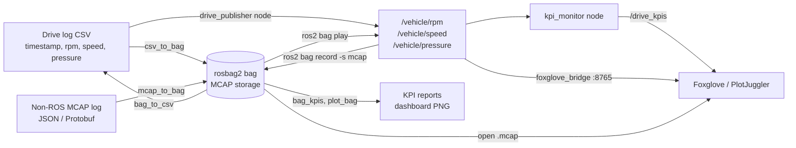

# ROS 2 Drive-Log Analytics: rosbag2, MCAP and KPIs

[](https://github.com/michealswolski/ROS-2/actions/workflows/ci.yml)


This ROS 2 package turns logged vehicle drive data (engine **RPM**, **vehicle speed** and **pressure**) into a standard **rosbag2** recording stored as **MCAP**. You can replay the recording with `ros2 bag play`, view it in **Foxglove** or **PlotJuggler**, and analyze it with drive and data-quality KPIs:

- max RPM, average speed and distance;
- idle time and hard-braking events;
- dropped messages.


<sub>Rendered from `bags/sample_drive` by `ros2 run drive_bag plot_bag`. Grey bands mark logger gaps, which are the dropped samples.</sub>

---

## Contents

- [Highlights](#highlights)
- [Results](#results-sample-drive)
- [Architecture](#architecture)
- [Quick start](#quick-start)
- [Installation](#installation)
- [Usage](#usage)
- [Using your own data](#using-your-own-data)
- [Visualization](#visualization-foxglove-and-plotjuggler)
- [KPI definitions](#kpi-definitions)
- [Command reference](#command-reference)
- [Testing and CI](#testing-and-ci)
- [Repository layout](#repository-layout)
- [Design notes](#design-notes)
- [Troubleshooting](#troubleshooting)
- [License](#license)

## Highlights

- **Logs to rosbag2 (MCAP).** Converts CSV exports, or existing **non-ROS MCAP** logs with JSON or Protobuf channels, into rosbag2 bags that play back with ROS 2's standard tools. Each message keeps its original logger timestamp, so replay reproduces the real drive timing, including its gaps.
- **Replay with live analytics.** One launch file runs `ros2 bag play` alongside a `kpi_monitor` node. The node:
  - computes KPIs as messages arrive;
  - publishes them on `/drive_kpis`;
  - checks that every recorded message was delivered.
- **Offline KPIs and reports.** Writes JSON and Markdown KPI reports and a dashboard image directly from the bag, and exports the bag back to CSV for Excel or pandas.
- **Foxglove and PlotJuggler.** Ships ready-made layouts and a live streaming mode through `foxglove_bridge`. CI checks the live stream automatically.
- **Reproducible.** The setup has three parts:
  - a Docker image with ROS 2 Jazzy and every dependency;
  - a Makefile that wraps the common tasks;
  - 18 tests under `colcon test`, plus GitHub Actions CI that runs the full pipeline on every push.

## Results (sample drive)

The repository ships a 4 min 40 s drive sampled at 20 Hz, covering city, highway and city again. It contains **16,719 messages** across three topics in a 968 KiB MCAP file.

| KPI | Value |
|---|---|
| Max RPM | **3,231 rpm** |
| Average speed (all samples / moving only) | **58.9 km/h** / 71.4 km/h |
| Max speed | 115.3 km/h |
| Distance | 4.58 km |
| Idle time (stopped, engine running) | 49.0 s |
| Hard braking / hard acceleration events (> 3 m/s²) | 1 / 0 |
| Pressure min / max | 169 / 388 kPa |
| Dropped messages in the log | **81 of 16,800 expected (0.48%)** |
| Dropped messages during `ros2 bag play` | **0** (16,719 sent, 16,719 received) |

| Topic | Received | Expected | Dropped | Gap events | Longest gap |
|---|---:|---:|---:|---:|---|
| `/vehicle/rpm` | 5,581 | 5,600 | 19 | 19 | 0.10 s |
| `/vehicle/speed` | 5,580 | 5,600 | 20 | 20 | 0.10 s |
| `/vehicle/pressure` | 5,558 | 5,600 | 42 | 11 | 1.65 s (sensor dropout) |

Dropped messages are measured at two independent points:

1. **At the logger.** Gaps in the recorded timestamps, compared with the nominal sample rate, reveal missed CAN frames and sensor dropouts in the source data.
2. **In transport.** The message counts in the bag's `metadata.yaml` are compared with what `kpi_monitor` actually received over DDS during replay.

Full outputs: [`results/kpis.md`](results/kpis.md), [`results/kpis.json`](results/kpis.json), [`results/replay_kpis.json`](results/replay_kpis.json), [`results/bag_info.txt`](results/bag_info.txt).

## Architecture



| Topic | Type | Unit | Published by |
|---|---|---|---|
| `/vehicle/rpm` | `std_msgs/msg/Float64` | rpm | `ros2 bag play` or `drive_publisher` |
| `/vehicle/speed` | `std_msgs/msg/Float64` | km/h | `ros2 bag play` or `drive_publisher` |
| `/vehicle/pressure` | `std_msgs/msg/Float64` | kPa | `ros2 bag play` or `drive_publisher` |
| `/drive_kpis` | `std_msgs/msg/String` (JSON) | live KPI summary, 1 Hz | `kpi_monitor` |

## Quick start

The quickest route needs only Docker and `make`:

```bash
git clone https://github.com/michealswolski/ROS-2.git && cd ROS-2
make demo
```

`make demo` builds the image (ROS 2 Jazzy, `foxglove_bridge` and this package) and runs [`scripts/run_demo.sh`](scripts/run_demo.sh). In about a minute, it:

1. converts `data/sample_drive.csv` to an MCAP bag and prints `ros2 bag info`;
2. converts a JSON-encoded, non-ROS MCAP log to a bag, the same path your own logger output would take;
3. replays the bag at 5x speed while `kpi_monitor` computes live KPIs;
4. writes offline KPI reports to `results/`;
5. exports the bag to CSV and renders `docs/drive_dashboard.png`.

| Command | Purpose |
|---|---|
| `make demo` | Run the end-to-end pipeline above |
| `make test` | Run the full `colcon test` suite in the container |
| `make live` | Replay on a loop and stream to Foxglove at `ws://localhost:8765` |
| `make foxglove` | Automated check that `foxglove_bridge` streams all three topics |
| `make shell` | Open an interactive shell with ROS 2 and the package sourced |

## Installation

### Option A: Docker (recommended)

```bash
docker build -t ros2-drive-bag .
docker run --rm --user "$(id -u):$(id -g)" -v "$PWD":/project ros2-drive-bag scripts/run_demo.sh
```

The image runs as a non-root user, so the files it writes to your checkout stay owned by you. If your build machine cannot reach `packages.ros.org`, add `--build-arg WITH_FOXGLOVE_BRIDGE=0`. Everything except the live Foxglove stream still works.

### Option B: Native (Ubuntu 24.04)

1. Install ROS 2 Jazzy by following the [official guide](https://docs.ros.org/en/jazzy/Installation/Ubuntu-Install-Debs.html).
2. Install the dependencies and build the package:

```bash
sudo apt install ros-jazzy-ros-base ros-jazzy-rosbag2-storage-mcap ros-jazzy-foxglove-bridge \
    python3-colcon-common-extensions python3-matplotlib python3-pip python3-protobuf
pip3 install --break-system-packages mcap==1.5.0    # only needed for mcap_to_bag

source /opt/ros/jazzy/setup.bash
colcon build --symlink-install --base-paths src
source install/setup.bash
```

## Usage

### 1. Convert a drive log to a bag

```bash
ros2 run drive_bag csv_to_bag data/sample_drive.csv -o bags/sample_drive --force
ros2 bag info bags/sample_drive
```

### 2. Replay it as ROS 2 topics

```bash
ros2 bag play bags/sample_drive
# in a second terminal
ros2 topic echo /vehicle/rpm
```

### 3. Replay with live KPIs

```bash
ros2 launch drive_bag replay.launch.py bag:=bags/sample_drive rate:=5.0
```

When playback ends, `kpi_monitor` prints a summary and writes `results/replay_kpis.json`. Two launch arguments change this behavior:

- `loop:=true` replays continuously;
- `foxglove:=true` also starts `foxglove_bridge`.

### 4. Offline KPIs, dashboard and CSV export

```bash
ros2 run drive_bag bag_kpis   bags/sample_drive -o results
ros2 run drive_bag plot_bag   bags/sample_drive -o docs/drive_dashboard.png
ros2 run drive_bag bag_to_csv bags/sample_drive -o drive_export.csv
```

### 5. Record from live topics (vehicle workflow)

```bash
ros2 bag record -s mcap -o bags/live_drive /vehicle/rpm /vehicle/speed /vehicle/pressure &
ros2 run drive_bag drive_publisher --ros-args -p csv:=data/sample_drive.csv -p rate:=1.0
```

A live recording stores the time each message was received, not the logger's time. Record at `rate:=1.0` to keep the gap-based drop KPI meaningful. `csv_to_bag` and `mcap_to_bag` keep the original timestamps exactly.

## Using your own data

### From a CSV export

The CSV needs a time column (seconds since the start of the log, or Unix epoch) and one column per signal. Map your column names onto the three signals with flags. Blank or `NaN` cells count as missed samples.

```bash
ros2 run drive_bag csv_to_bag my_drive.csv -o bags/my_drive \
    --time-col time --rpm-col EngineRPM --speed-col VehicleSpeed --pressure-col OilPressure \
    --zstd
ros2 run drive_bag bag_kpis bags/my_drive --rate-hz 50     # your logger's nominal rate
```

### From an existing MCAP log

Many loggers write MCAP files whose channels are JSON or Protobuf rather than ROS 2 CDR. The Foxglove SDK and custom CAN loggers are common examples. `ros2 bag play` cannot replay those files directly, so `mcap_to_bag` converts them:

```bash
ros2 run drive_bag mcap_to_bag my_log.mcap -o bags/my_drive \
    --rpm /engine:rpm \
    --speed /vehicle:speed_mps \
    --pressure /engine:oil.pressure_kpa \
    --scale speed=3.6            # m/s -> km/h
```

- **Field specs** take the form `TOPIC:FIELD.PATH`. Nested objects and list indexes work, for example `/can:wheels.0.speed`.
- **Protobuf** messages are decoded with the schema embedded in the MCAP file, so no generated code is needed.
- **Missing fields:** a message that lacks the requested field counts as a missed sample.
- **ROS 2 input:** if the MCAP is already ROS 2 (CDR), the tool says so. That file can be played directly, after `ros2 bag reindex` if it has no `metadata.yaml`.

## Visualization: Foxglove and PlotJuggler

### Foxglove

| Mode | How |
|---|---|
| **File** | Open `bags/sample_drive/sample_drive_0.mcap` with *Open local file*. The MCAP embeds the `ros2msg` schemas, so no ROS installation is needed. |
| **Live** | Run `make live`, then choose *Open connection → Foxglove WebSocket → `ws://localhost:8765`*. |
| **Layout** | Import [`foxglove/drive_layout.json`](foxglove/drive_layout.json) via *Layouts → Import* to get three synchronized plots and a `/drive_kpis` panel. |

### PlotJuggler

1. Install with `sudo apt install ros-jazzy-plotjuggler-ros`, then launch with `ros2 run plotjuggler plotjuggler`.
2. Load the `.mcap` file with *Data → Load*, or subscribe with *ROS2 Topic Subscriber* while `ros2 bag play` runs.
3. Apply [`plotjuggler/drive_layout.xml`](plotjuggler/drive_layout.xml) with *Layout → Load*.

## KPI definitions

| KPI | Definition |
|---|---|
| Max RPM | Maximum value on `/vehicle/rpm` |
| Average speed | Mean of all `/vehicle/speed` samples. The "moving" variant only uses samples above 1 km/h. |
| Distance | Trapezoidal integral of speed over the bag timestamps |
| Idle time | Time during which speed stays below 1 km/h |
| Hard braking / acceleration | Speed change over a 1 s window that exceeds ±3 m/s². An event ends once the value drops below 80% of the threshold, so a value hovering at the limit is counted once. |
| Dropped messages (log) | `round(log span × nominal rate) + 1 − received`, per topic. Each gap longer than 1.5 sample periods counts as one gap event. |
| Dropped messages (replay) | Messages listed in the bag metadata minus messages received by `kpi_monitor` |

The thresholds are named constants at the top of [`kpi.py`](src/drive_bag/drive_bag/kpi.py).

## Command reference

Run each tool with `ros2 run drive_bag <tool>`. Add `-h` to any tool for its full help.

| Tool | Purpose | Key options |
|---|---|---|
| `csv_to_bag` | CSV → rosbag2 (MCAP) | `-o DIR`, `--time-col`, `--rpm-col`, `--speed-col`, `--pressure-col`, `--start-epoch`, `--zstd`, `-f` |
| `mcap_to_bag` | Non-ROS MCAP (JSON or Protobuf) → rosbag2 | `-o DIR`, `--rpm/--speed/--pressure TOPIC:FIELD`, `--scale SIGNAL=FACTOR`, `--zstd`, `-f` |
| `bag_kpis` | KPI report (JSON and Markdown) | `--rate-hz`, `-o DIR` |
| `plot_bag` | Dashboard PNG | `-o FILE`, `--rate-hz` |
| `bag_to_csv` | rosbag2 → CSV | `-o FILE`, `--epoch` |
| `generate_sample` | Synthetic drive log (`.csv` or JSON `.mcap`) | `-o FILE`, `--rate-hz`, `--seed` |
| `drive_publisher` *(node)* | Publishes a CSV live on `/vehicle/*` | parameters `csv`, `rate` |
| `kpi_monitor` *(node)* | Live KPIs, published on `/drive_kpis` | parameters `bag`, `output`, `idle_timeout_s`, `report_period_s` |

Arguments for `ros2 launch drive_bag replay.launch.py`:

| Argument | Default | Meaning |
|---|---|---|
| `bag` | `bags/sample_drive` | Bag to replay |
| `rate` | `1.0` | Playback speed multiplier |
| `output` | `results/replay_kpis.json` | Where `kpi_monitor` writes its summary |
| `loop` | `false` | Replay continuously |
| `foxglove` | `false` | Also start `foxglove_bridge` |
| `foxglove_port` | `8765` | WebSocket port for `foxglove_bridge` |

## Testing and CI

`colcon test` (or `make test`) runs 18 tests:

| Suite | What it covers |
|---|---|
| `test_kpi.py` | Drop counting, distance, idle time, and hard-event detection including its hysteresis |
| `test_bag_io.py` | CSV → bag → CSV round trip with exact values and timestamps. KPIs identical before and after conversion. JSON and Protobuf MCAP input, including nested fields and scaling. Errors for empty input, missing columns and ROS 2 MCAP input. |
| `test_replay.py` | End-to-end `ros2 launch` run, asserting that every message in the bag reaches `kpi_monitor` |
| `test_flake8.py` | ROS 2 (ament) code style |

[GitHub Actions](.github/workflows/ci.yml) runs two jobs on every push and pull request:

1. **`ros:jazzy` container.** It builds the package and runs the test suite. It then runs a CSV → bag → replay → KPI check that asserts zero replay loss.
2. **Docker image.** It builds the image with `foxglove_bridge` and runs the demo as a non-root user. It then runs [`scripts/foxglove_check.sh`](scripts/foxglove_check.sh), which connects to the bridge the way the Foxglove app does, subscribes to all three topics and decodes their values.

## Repository layout

```
src/drive_bag/                    ROS 2 ament_python package
├── drive_bag/
│   ├── csv_to_bag.py             CSV → rosbag2 (MCAP) writer
│   ├── mcap_to_bag.py            non-ROS MCAP (JSON / Protobuf) → rosbag2
│   ├── bag_to_csv.py             rosbag2 → CSV export
│   ├── bag_reader.py             reads /vehicle/* back out of a bag
│   ├── bag_kpis.py               offline KPI report
│   ├── plot_bag.py               dashboard PNG
│   ├── kpi.py                    KPI math (pure Python)
│   ├── kpi_monitor.py            node: live KPIs during replay
│   ├── drive_publisher.py        node: publishes a CSV as live topics
│   ├── drive_log.py              signal and topic definitions, CSV parsing
│   └── generate_sample.py        synthetic drive log generator
├── launch/replay.launch.py       ros2 bag play + kpi_monitor (+ foxglove_bridge)
└── test/                         unit, bag I/O, replay and lint tests
data/sample_drive.csv             sample 20 Hz drive log
bags/sample_drive/                sample rosbag2 bag (MCAP + metadata.yaml)
results/                          KPI outputs from the last demo run
docs/drive_dashboard.png          dashboard image
foxglove/, plotjuggler/           viewer layouts
scripts/                          demo and Foxglove bridge check
Dockerfile, Makefile              container environment and shortcuts
.github/workflows/ci.yml          continuous integration
```

## Design notes

- **One `std_msgs/Float64` topic per signal.** Scalar topics plot directly in every ROS tool and need no custom message build. They also map one-to-one onto typical CAN or logger channels.
- **Logger time, not wall-clock time.** Bags are written through `rosbag2_py` with the original sample timestamps instead of being recorded live. This keeps replay timing faithful and makes gap-based drop detection exact.
- **Two independent drop measurements.** Comparing logger gaps with replay delivery separates data-quality problems at the source from transport problems in the ROS graph.
- **Pure-Python KPI core.** `kpi.py` has no ROS imports. The offline reports and the dashboard share it, and it can be unit-tested anywhere.

## Troubleshooting

| Symptom | Fix |
|---|---|
| `docker build` fails fetching `ros-jazzy-foxglove-bridge` | Rebuild with `--build-arg WITH_FOXGLOVE_BRIDGE=0`. Only the live Foxglove stream is lost. |
| `mcap_to_bag`: `No module named 'mcap'` | Run `pip3 install --break-system-packages mcap==1.5.0`. The Docker image already includes it. |
| `mcap_to_bag`: "already ROS 2 (cdr)" | The file is already a ROS 2 recording. Play it directly, running `ros2 bag reindex <dir> -s mcap` first if `metadata.yaml` is missing. |
| Dropped-message count looks too high | Pass your logger's real rate with `--rate-hz`. The default is 20 Hz. |
| Foxglove shows no data in live mode | Check that port 8765 is published (`make live` does this) and that playback is running with `loop:=true`. |

## About the sample data

`data/sample_drive.csv` is synthetic so that the repository is self-contained. It was generated by `ros2 run drive_bag generate_sample` with a fixed seed, from four components:

- a city → highway → city speed profile;
- a 6-speed gearbox model for RPM;
- an oil-pressure model that follows RPM;
- injected logger faults: about 0.2–0.3% random single-sample drops per signal, plus a 1.6 s pressure-sensor dropout.

To get results from a real drive, convert your own log as described in [Using your own data](#using-your-own-data) and rerun `make demo`.

## License

Released under the [MIT License](LICENSE).
