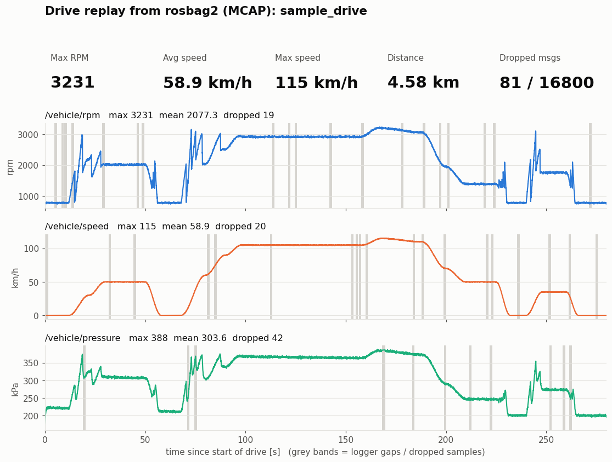
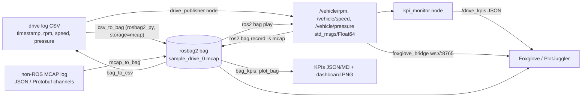

# ROS 2 drive-log rosbag project

This project takes logged vehicle drive data (engine **RPM**, **speed** and **pressure**) and runs it through a ROS 2 pipeline:

1. It runs on **ROS 2 Jazzy**, natively on Ubuntu 24.04 or in Docker.
2. It converts the drive log into a **rosbag2** bag stored as **MCAP**.
3. It publishes the signals as ROS 2 topics and **replays** them with `ros2 bag play`.
4. It shows the data in **Foxglove / PlotJuggler** (layouts and a live `foxglove_bridge` mode included) and computes **KPIs**: max RPM, average speed, dropped messages, distance, idle time and hard-braking events.

It reads drive logs from **CSV** or from existing **non-ROS MCAP** files (JSON or Protobuf channels), and it exports bags back to CSV. Everything is covered by `colcon test` and CI.



*Rendered from `bags/sample_drive` by `ros2 run drive_bag plot_bag`. Grey bands mark logger gaps, which are the dropped samples.*

## Results (sample drive)

The sample drive lasts 4 min 40 s at 20 Hz and covers city, highway and back to city. It produced **16,719 messages** across three topics in a 968 KiB MCAP file.

| KPI | Value |
|---|---|
| Max RPM | **3231 rpm** |
| Average speed (all samples) | **58.9 km/h** |
| Average speed (moving, >1 km/h) | 71.4 km/h |
| Max speed | 115.3 km/h |
| Distance | 4.58 km |
| Idle time (stopped) | 49.0 s |
| Hard braking / hard acceleration events (> 3 m/s²) | 1 / 0 |
| Pressure min / max | 169 / 388 kPa |
| Dropped messages in the log | **81 of 16,800 expected (0.48%)** |
| Dropped messages during `ros2 bag play` | **0** (16,719 sent, 16,719 received) |

| Signal | Count | Expected | Dropped | Gap events | Longest gap |
|---|---|---|---|---|---|
| `/vehicle/rpm` | 5581 | 5600 | 19 | 19 | 0.10 s |
| `/vehicle/speed` | 5580 | 5600 | 20 | 20 | 0.10 s |
| `/vehicle/pressure` | 5558 | 5600 | 42 | 11 | 1.65 s (sensor dropout) |

The pipeline counts dropped messages in two ways:

* **In the log:** gaps in the recorded timestamps compared with the nominal 20 Hz rate. These come from the data logger itself. Examples are single missed CAN frames and the 1.6 s pressure-sensor dropout.
* **In replay:** the per-topic message counts in the bag's `metadata.yaml`, compared with what the `kpi_monitor` node actually received over DDS during `ros2 bag play`.

Full output is in [`results/kpis.md`](results/kpis.md), [`results/kpis.json`](results/kpis.json), [`results/replay_kpis.json`](results/replay_kpis.json) and [`results/bag_info.txt`](results/bag_info.txt).

## How it works



| Topic | Type | Unit |
|---|---|---|
| `/vehicle/rpm` | `std_msgs/msg/Float64` | rpm |
| `/vehicle/speed` | `std_msgs/msg/Float64` | km/h |
| `/vehicle/pressure` | `std_msgs/msg/Float64` | kPa |
| `/drive_kpis` | `std_msgs/msg/String` (JSON) | live KPI summary, 1 Hz |

Every message is written with the logger's original timestamp, so `ros2 bag play` reproduces the drive's real timing, including its gaps.

## Quick start (Docker)

```bash
make demo       # = docker build -t ros2-drive-bag . && docker run ... scripts/run_demo.sh
```

[`scripts/run_demo.sh`](scripts/run_demo.sh) runs the whole pipeline at 5x playback speed in about a minute. It:

1. converts the CSV to an MCAP bag and runs `ros2 bag info`;
2. converts a JSON-encoded, non-ROS MCAP log to a bag, the same way your own logger output would go;
3. replays the bag with `ros2 bag play` while `kpi_monitor` listens;
4. computes the offline KPIs;
5. exports the bag back to CSV and renders the dashboard.

Other targets:

| Command | What it does |
|---|---|
| `make test` | `colcon test`: KPI unit tests, bag I/O, MCAP input, replay end to end, flake8 |
| `make live` | Replays the bag forever with `foxglove_bridge` on `ws://localhost:8765`. Open Foxglove → *Open connection*. |
| `make foxglove` | Automated check that the bridge streams all three topics to a Foxglove-style client |
| `make shell` | Interactive shell with ROS 2 and the package sourced |

Without `make`, run `docker build -t ros2-drive-bag .` and then `docker run --rm --user "$(id -u):$(id -g)" -v "$PWD":/project ros2-drive-bag scripts/run_demo.sh`. If packages.ros.org is unreachable from your build machine, add `--build-arg WITH_FOXGLOVE_BRIDGE=0`; everything except the live Foxglove view still works.

## Native install (Ubuntu 24.04)

```bash
# ROS 2 Jazzy: https://docs.ros.org/en/jazzy/Installation/Ubuntu-Install-Debs.html
sudo apt install ros-jazzy-ros-base ros-jazzy-rosbag2-storage-mcap ros-jazzy-foxglove-bridge \
    python3-colcon-common-extensions python3-matplotlib python3-pip python3-protobuf
pip3 install --break-system-packages mcap==1.5.0   # only needed for mcap_to_bag
source /opt/ros/jazzy/setup.bash
colcon build --symlink-install --base-paths src
source install/setup.bash
```

## Step by step

```bash
# 1. CSV -> rosbag2 (MCAP)
ros2 run drive_bag csv_to_bag data/sample_drive.csv -o bags/sample_drive --force
ros2 bag info bags/sample_drive

# 2. Replay as topics. In another terminal, run: ros2 topic echo /vehicle/rpm
ros2 bag play bags/sample_drive

# 3. Replay + live KPIs in one command (the monitor exits when playback goes quiet)
ros2 launch drive_bag replay.launch.py bag:=bags/sample_drive rate:=5.0

# 4. Offline KPIs + dashboard PNG
ros2 run drive_bag bag_kpis bags/sample_drive -o results
ros2 run drive_bag plot_bag bags/sample_drive -o docs/drive_dashboard.png

# 5. Bag -> CSV (for Excel / pandas)
ros2 run drive_bag bag_to_csv bags/sample_drive -o drive_export.csv
```

To record the bag from live topics instead, the way you would on a vehicle:

```bash
ros2 bag record -s mcap -o bags/live_drive /vehicle/rpm /vehicle/speed /vehicle/pressure &
ros2 run drive_bag drive_publisher --ros-args -p csv:=data/sample_drive.csv -p rate:=1.0
```

A recorded bag stores receive time, not the logger's time. Record at `rate:=1.0` if you want the gap-based drop KPI to stay meaningful. `csv_to_bag` keeps the original timestamps exactly.

## Using your own drive log

`csv_to_bag` reads any CSV that has a time column (relative seconds or Unix epoch) and one column per signal. Blank or `NaN` cells count as missed samples.

```bash
ros2 run drive_bag csv_to_bag my_drive.csv -o bags/my_drive \
    --time-col time --rpm-col EngineRPM --speed-col VehicleSpeed --pressure-col OilPressure \
    --zstd                       # optional MCAP chunk compression
ros2 run drive_bag bag_kpis bags/my_drive --rate-hz 50   # set your logger's nominal rate
```

### From an existing MCAP log

If your logger already writes MCAP but the channels are JSON or Protobuf (for example the Foxglove SDK or a custom CAN logger), `ros2 bag play` can't replay it directly. `mcap_to_bag` converts it. Point each signal at `TOPIC:FIELD.PATH`, where nested fields and list indexes such as `wheels.0.speed` work too. Protobuf schemas are read from the file itself, so you don't need generated code.

```bash
ros2 run drive_bag mcap_to_bag my_log.mcap -o bags/my_drive \
    --rpm /engine:rpm --speed /vehicle:speed_mps --pressure /engine:oil.pressure_kpa \
    --scale speed=3.6            # m/s -> km/h
```

Each message keeps its MCAP log time. A message that lacks the field counts as a missed sample. If the MCAP is already ROS 2 (CDR), the tool says so: that file can be played directly, after `ros2 bag reindex` if it has no `metadata.yaml`.

## Viewing in Foxglove or PlotJuggler

**Foxglove** (desktop or app.foxglove.dev):

1. Open `bags/sample_drive/sample_drive_0.mcap` with *Open local file*. The MCAP embeds the `ros2msg` schemas, so no ROS install is needed.
2. Import [`foxglove/drive_layout.json`](foxglove/drive_layout.json) with *Layouts → Import*. You get three synced plots plus a `/drive_kpis` panel.
3. **Live**: run `make live` (or `ros2 launch drive_bag replay.launch.py foxglove:=true loop:=true`). In Foxglove choose *Open connection → Foxglove WebSocket → ws://localhost:8765*. You see the replay as it plays, plus the `/drive_kpis` summary from `kpi_monitor`.

[`scripts/foxglove_smoke_test.py`](scripts/foxglove_smoke_test.py) checks that path in CI. It connects to the bridge the way the Foxglove app does, subscribes to the three topics and decodes the `Float64` values.

**PlotJuggler**:

1. Install it with `sudo apt install ros-jazzy-plotjuggler-ros`, then run `ros2 run plotjuggler plotjuggler`.
2. Load the `.mcap` file with *Data → Load*, or use the *ROS2 Topic Subscriber* while `ros2 bag play` runs.
3. Apply [`plotjuggler/drive_layout.xml`](plotjuggler/drive_layout.xml) with *Layout → Load*.

## KPI definitions

| KPI | Definition |
|---|---|
| Max RPM | Maximum of `/vehicle/rpm` |
| Average speed | Mean of all `/vehicle/speed` samples. The "moving" variant only uses samples above 1 km/h. |
| Distance | Trapezoidal integral of speed over the bag timestamps |
| Idle time | Time with speed below 1 km/h (vehicle stopped, engine running) |
| Hard braking / acceleration events | Speed change over a 1 s window beyond ±3 m/s². An event ends once the value drops below 80% of the threshold, so values hovering near the limit count once. |
| Dropped messages (log) | `round(log span × nominal rate) + 1 − received`, per topic. Each gap longer than 1.5 periods counts as one gap event. |
| Dropped messages (replay) | Message count in the bag metadata minus the messages `kpi_monitor` received |

## Testing

`colcon test` (or `make test`) runs 18 tests:

* **KPI math**: drop counting, distance, idle time, harsh-event hysteresis.
* **Bag I/O**: CSV → bag → CSV round trip with bit-exact values and timestamps; KPIs identical before and after conversion; JSON and Protobuf MCAP input, including nested fields and scaling; clear errors for empty input, missing columns and ROS 2 MCAP input.
* **Replay end to end**: launches `replay.launch.py` and asserts that every message in the bag reaches `kpi_monitor`.
* **flake8** with the ROS 2 (ament) style rules.

CI runs two jobs on every push:

* the test suite plus a CSV → bag → replay → KPI check in `ros:jazzy-ros-base`;
* a build of the Docker image with `foxglove_bridge`, the demo run as a non-root user, and the Foxglove streaming check.

## Repository layout

```
src/drive_bag/                ROS 2 ament_python package
  drive_bag/csv_to_bag.py     CSV -> rosbag2 (MCAP) writer (rosbag2_py)
  drive_bag/mcap_to_bag.py    non-ROS MCAP (JSON / Protobuf) -> rosbag2
  drive_bag/bag_to_csv.py     rosbag2 -> CSV export
  drive_bag/drive_publisher.py  node: publish the CSV live as topics
  drive_bag/kpi_monitor.py    node: live KPIs during ros2 bag play, /drive_kpis
  drive_bag/bag_kpis.py       offline KPIs from a bag -> results/
  drive_bag/plot_bag.py       dashboard PNG from a bag
  drive_bag/kpi.py            KPI math (pure Python, unit tested)
  drive_bag/generate_sample.py  synthetic drive log generator
  launch/replay.launch.py     ros2 bag play + kpi_monitor (+ foxglove_bridge, loop)
  test/                       unit, bag I/O, replay end-to-end and flake8 tests
data/sample_drive.csv         20 Hz drive log (synthetic, see below)
bags/sample_drive/            the rosbag2 MCAP bag + metadata.yaml
results/                      KPI outputs from the last run
foxglove/, plotjuggler/       viewer layouts
Dockerfile, Makefile          containerised ROS 2 Jazzy + foxglove_bridge environment
scripts/                      demo, Foxglove bridge check
.github/workflows/ci.yml      CI: tests, replay check, Docker image + Foxglove check
```

## About the sample data

`data/sample_drive.csv` is synthetic, so the repository is self-contained. It was generated with `ros2 run drive_bag generate_sample` (fixed seed) from:

* a city → highway → city speed profile;
* a 6-speed gearbox model for RPM;
* an RPM-following oil-pressure model;
* injected logger faults: about 0.2–0.3% random single-sample drops per signal, plus a 1.6 s pressure-sensor dropout.

To produce real numbers, swap in your own export (see [Using your own drive log](#using-your-own-drive-log)) and rerun `scripts/run_demo.sh`.
